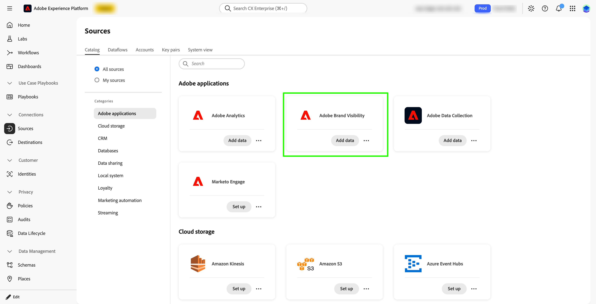
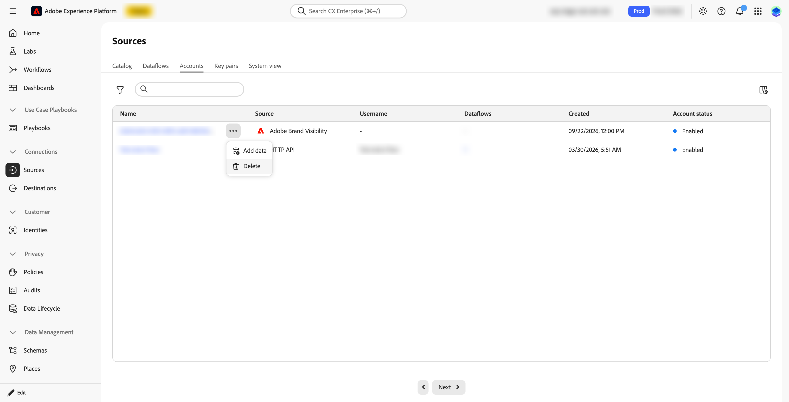

# Setup and configure inbound integration

This article details the [prerequisites](#prerequisites), [responsibilities](#responsibilities), [steps to verify](#verification), [troubleshoot steps](#troubleshoot), and [completion criteria](#completion-criteria) for setting up and configuring the Brand Visibility inbound integration with Customer Journey Analytics.

## Prerequisites

Consider the following prerequisites before enabling the inbound integration. Use the [verification procedure](#verification) below to confirm each prerequisite.

### BYOCDN log forwarding

CDN access logs must be forwarded to and received by Adobe Brand Visibility for each Brand Visibility site before the Brand Visibility source connector can be viable.

This requirement applies for each Brand Visibility site. A CDN configuration or log feed for one site, domain, or subdomain covers only that site.

Confirm both parts of the handoff:

1. You have configured the relevant CDN or log pipeline to forward the required access logs to the Adobe-provided Amazon S3 destination.
1. Brand Visibility is receiving and detecting the logs for the relevant site. The site is then available to select in the Adobe Brand Visibility source in Experience Platform.

BYOCDN Log Forwarding provides the server-side CDN request data used for automated-agent traffic analysis. The data does not depend on JavaScript tags running in a browser. The required
CDN log feed ensures the downstream summary dataset contains the intended Brand Visibility agentic-traffic data. See the [BYOCDN log forwarding reference](https://experienceleague.adobe.com/en/docs/brand-visibility/using/log-forwarding/log-forwarding-overview) for more information.

### Required information

Ensure you have values for all required details listed in the table below for each Brand Visibility site.

| Required value | Verification or notes |
|---|---|
| Brand Visibility site or domain | Confirm the site covered by CDN log forwarding. |
| CDN provider | Identify the CDN that serves the site. |
| CDN log forwarding status | Proof that logs for the site are forwarded and detected by the Brand Visibility. |
| Site available in Brand Visibility source | Confirm that the site is available to select in the Brand Visibility source. A site is available based on the availability of parsed CDN logs in Brand Visibility. |
| IMS organization | Use the exact IMS organization associated with Brand Visibility, Experience Platform. |
| Sandbox | Use the exact sandbox name that is designated for the inbound integration. |
| Connection | Identify the Customer Journey connection that should include the dataset. |
| Data view | Identify a new or existing Customer Journey Analytics data view that should include the components. |
| Administrator or owner | Provide name or team that is the configuration contact. |

Confirm that each site is available to select in the Adobe Brand Visibility source before you continue.

### Sandbox

You can add the dataset to the CJA connection after the dataset appears in **[!UICONTROL Datasets]** in that sandbox. 

Confirm the following:

* IMS Organization
* Target Experience Platform sandbox

The target AEP sandbox is the same named sandbox used by the corresponding Customer Journey Analytics connection or connections that include the dataset. 

The customer can add the dataset to the appropriate CJA Connection only after Adobe confirms that the managed dataset has been created.

### Summary dataset

The inbound integration provides an aggregated summary dataset in Experience Platform that contains server-side CDN request information associated with LLM, bot, and automated-agent
traffic.

Brand Visibility uses CDN access logs to identify requests from bots and automated agents. This traffic does not fire browser JavaScript tags and therefore is not captured through a conventional web analytics implementation.

For the detailed description of the inbound integration, dataset structure, and available fields, see [about the dataset](#about-the-dataset).

The Brand Visibility source creates the summary dataset in Experience Platform using:

* The **[!UICONTROL XDM Summary Metrics]** class
* The **[!UICONTROL CDN Requests Summary]** field group
* Fields organized under a **[!UICONTROL cdn]** object

The connector creates the dataset for each Brand Visibility site, using the following naming pattern: <code>Adobe Brand Visibility (ABV) Dataset - _baseUrl without scheme_</code>.  For example `Adobe Brand Visibility (ABV) Dataset - example.com` for the site <https://example.com>.

Datasets created before this naming convention was adopted display the earlier pattern <code>LLM Optimization (LLMO) Dataset - _baseUrl without scheme_</code>. 

Find the dataset in **[!UICONTROL Datasets]** in the sandbox where you created the dataflow..

The dataset is aggregated summary data. When analyzing request volume in Customer Journey Analytics, use the provided **[!UICONTROL CDN Request Count]** metric rather than counting dataset rows. 

Verify the available fields in the dataset schema created for the specific Brand Visibility site. To plan the configuration of the data view, review the fields.

## Responsibilities

After you enable the Brand Visibility source, Brand Visibility:

* Delivers the summary dataset for the site you selected. 
* Lands the dataset in the sandbox where you created the dataflow.

Your responsibilities as a customer are:

* To ensure  that CDN logs are forwarded to and received by Brand Visibility for each Brand Visibility site.
* To enable the Brand Visibility source in the correct sandbox, confirm that your site is available to select, and select it.
* To select the Customer Journey Analytics connection that should include the dataset.
* To add the dataset to that connection.
* To select the fields to expose as components in the relevant Customer Journey Analytics data view.
* To validate that the resulting dimensions and metrics support the intended analysis.

>[!IMPORTANT]
>
>The managed connector intentionally stops after creating and populating the Experience Platform dataset. Adobe does not modify your Customer Journey Analytics connections or data views.

The dataset is not available for Customer Journey Analytics analysis until you add the dataset to a connection. The data
is not available to users through a data view until the relevant fields have been added to that data view.

To enable the source:

1. In Experience Platform, select the sandbox in which you want the dataset. A site can be allocated only once, so make sure this is the sandbox you want.  
1. Go to **[!UICONTROL Sources]**, then **[!UICONTROL Catalog]**, then Adobe applications. On the **[!UICONTROL Adobe Brand Visibility]** card, select **[!UICONTROL Set up]** the first time. After that, the card shows **[!UICONTROL Add data]**.

   

1. Select **[!UICONTROL Add data]**. 

   

1. On the ➊ **[!UICONTROL Select data]** step:
   
   1. Select the site from the **[!UICONTROL Site name]** table. Once a site is allocated to a dataflow, you cannot select the site again in that sandbox or in any other sandbox. 

      

   1. Select **[!UICONTROL Next]**.

1. On the ➋ **[!UICONTROL Dataflow detail]** step:
   
   1. Enter a **[!UICONTROL Dataflow name]** and an optional **[!UICONTROL Description]**. You can also subscribe to the alerts **[!UICONTROL Sources Dataflow Run Start]**, **[!UICONTROL Sources Dataflow Run Success]**, and **[!UICONTROL Sources Dataflow Run Failure]**.

      

   1. Select **[!UICONTROL Next]**. 
  
1. On the ➌ **[!UICONTROL Review]** step:
   
   1. Check the connection and the dataset assignment.
   
      

   1. select **[!UICONTROL Finish]**.

The dataset is assigned automatically and no field mapping is required.

>[!IMPORTANT]
>
>A site can be allocated only once. To use the site in a different sandbox, delete the dataflow that the site is allocated to. Deleting the dataflow impacts any Customer Journey Analytics connection or data view that relies on the data from this source.
>

## Verification

Use the following procedure to verify the inbound integration:

1. Confirm ABV site and CDN-log readiness.

   For each ABV site:

   * Confirm the exact site or domain covered by CDN log forwarding.
   * Confirm that the site is available to select in the Brand Visibility source in Experience Platform. A site is available based on the availability of parsed CDN logs in Brand Visibility.
   * Do not proceed on a general statement that "CDN logs are enabled". Proceed when the specific ABV site is available to select.
   * Confirm that Brand Visibility is receiving or detecting logs for that site.
   * Obtain from Adobe the site's Brand Visibility readiness confirmation.

1. Verify the dataset in Experience Platform.

   After you create the dataflow:
   1. Login to **[!UICONTROL Experience Platform]**.
   1. Select the sandbox in which you created the dataflow.
   1. Locate the dataset for your Brand Visibility site in **[!UICONTROL Datasets]**.
   1. Confirm that the dataset is associated with the expected Brand Visibility site.
   1. Record the **[!UICONTROL Dataset ID]** and linked **[!UICONTROL Schema]**.
   1. Review the dataset record count, latest ingestion information, and available sample data where permitted.
   1. Open the linked schema and verify the expected XDM structure:
      * Class: **[!UICONTROL XDM Summary Metrics]**
      * Field group: **[!UICONTROL CDN Requests Summary]**
      * Object: **[!UICONTROL cdn]**
      * Expected dimensions and metrics, such as **[!UICONTROL botType]**, **[!UICONTROL cdnProvider]**, **[!UICONTROL url]**, **[!UICONTROL host]**, **[!UICONTROL status]**, **[!UICONTROL requests]**, and **[!UICONTROL timeToFirstByte]**.

1. Add the dataset to a connection

   Your Customer Journey Analytics administrator must add the dataset to the intended Connection:
   
   1. Login to Customer Journey Analytics.
   1. [Create a new connection or edit the intended existing connection](/help/connections/create-connection.md). Confirm that the connection uses the same Experience Platform sandbox in which the dataset was created.
   1. Search for the dataset by name or dataset ID.
   1. Add the dataset to the connection.
   1. Configure the dataset settings according to the customer's Customer Journey Analytics design.
   1. Save the connection.
   1. To confirm that the dataset is included and that ingestion is progressing, review the connection details.

1. Configure or update the data view

   After the dataset is part of the Connection:
   1. Login to Customer Journey Analytics.
   1. [Create a new data view or edit the data view](/help/data-views/create-dataview.md) associated with the intended reporting use case.
   1. Select the connection that contains the managed Brand Visibility dataset.
   1. Add the required schema fields as dimensions or metrics.
   1. Include the fields needed for the planned analysis, such as:
      * **[!UICONTROL CDN Bot Type]**
      * **[!UICONTROL CDN Provider]**
      * **[!UICONTROL CDN URL]**
      * **[!UICONTROL CDN Host]**
      * **[!UICONTROL CDN HTTP Status]**
      * **[!UICONTROL CDN Request Count]**
      * **[!UICONTROL CDN Avg Time to First Byte]**
   1. Save the data view.
   1. Validate the fields in Analysis Workspace or the customer's selected reporting workflow.

1. Validate the end-to-end result
   
   Use a recent reporting period and verify that:

   * The expected Brand Visibility site is represented.
   * The expected CDN provider and host values are present.
   * Bot or automated-agent traffic is represented.
   * URL and HTTP-status dimensions contain expected values.
   * The CDN Request Count and performance metrics are available.
   * The dataset is included in the intended connection.
   * The required fields are exposed in the intended data view.

  The exact time required for data to become available depends on the ingestion and Customer Journey Analytics processing workflow.

## Troubleshoot

See below what to do if issues occur:

* The dataset does not appear in AEP.

  Verify that:

  * The IMS organization is correct.
  * The selected Experience Platform sandbox is correct.
  * The source was enabled after CDN log forwarding was working.
  * The dataset name or ID supplied by Adobe was used.
  * The dataset was created for the correct Brand Visibility site.

* The dataset exists but contains no expected data.

  Verify that: 
  * CDN logs are being forwarded for the exact Brand Visibility site.
  * Brand Visibility is receiving or detecting logs for the site.
  * The site or domain in the CDN configuration matches the Brand Visibility site.
  * The managed connector was enabled after CDN log readiness was confirmed.
  * The selected date range includes the period after log ingestion began.

* The dataset exists in Experience Platform but is unavailable in Customer Journey Analytics.
  
  Verify that:
  * The Customer Journey Analytics connection uses the same named Experience Platform sandbox.
  * The dataset was explicitly added to the connection.
  * The Customer Journey Analytics administrator has the required permissions.
  * The connection has been saved after the dataset was added.

* The dataset is in the connection but fields are not available for reporting.

  Verify that:
  * The data view selects the correct Customer Journey Analytics connection.
  * The expected schema fields were added as data view components.
  * The fields were placed in the intended **[!UICONTROL Dimensions]** or **[!UICONTROL Metrics]** section.
  * The data view was saved after the components were added.
  * The dataset schema matches the expected **[!UICONTROL CDN Requests Summary]** field group structure.

* The site is not in the list. 

  Verify that:
 
  * A site is available to select based on the availability of parsed CDN logs in Brand Visibility. 
  * CDN log forwarding is set up and working for the site. 
 
* The site cannot be selected. 
  
  Be aware that once a site is allocated to a dataflow, it cannot be selected again, in that sandbox or in any other sandbox. To use the site in a different sandbox, delete the dataflow that the site is allocated to. The site can then be selected again. Deleting the dataflow impacts any Customer Journey Analytics connection or data view that relies on the data from this source. 

* The dataflow shows a failed status. 
 
  Use the **[!UICONTROL Monitoring]** dashboard. The **[!UICONTROL Sources]** overview notes that a source dataflow that fails continuously for 30 days is disabled automatically.

## Completion criteria

The inbound integration is ready for customer-side Customer Journey Analytics configuration when all of the following are confirmed:

* CDN logs are forwarded to and received by Brand Visibility for each requested ABV site.
* Each Brand Visibility site is available to select in the Adobe Brand Visibility source.
* You enabled the Adobe Brand Visibility source in the intended sandbox.
* The per-site summary dataset appears in that sandbox.
* You verified the dataset and its XDM schema.
* You added the dataset to the intended CJA Connection.
* You configured the relevant CJA Data View components.

